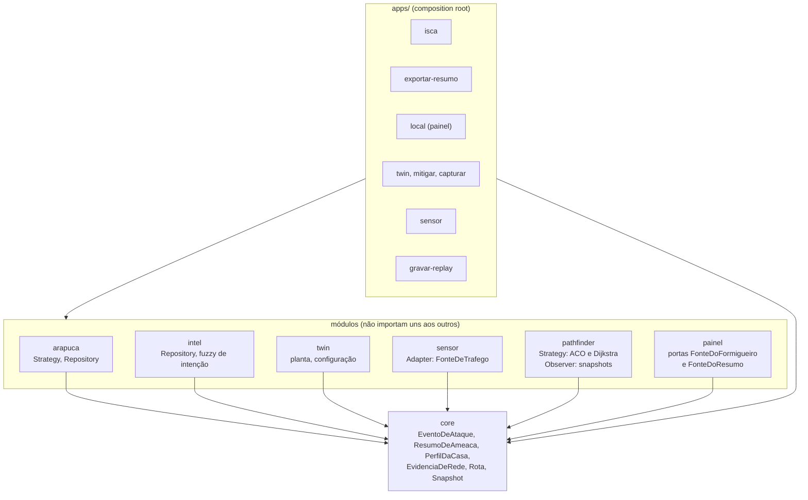
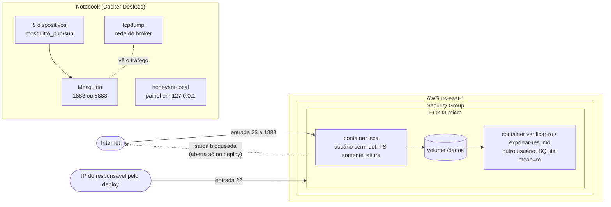

# Arquitetura do HoneyAnt

Quatro vistas, do mais amplo ao mais detalhado. Os diagramas são Mermaid: o GitHub os
desenha direto nesta página. As decisões por trás de cada escolha estão nos
[ADRs](../adr/).

## 1. Contexto

Quem fala com quem. A isca na nuvem recebe ataques reais; só um **resumo sem IPs** sai de
lá e chega ao notebook, onde a casa simulada, o sensor, o pathfinder e o painel rodam.

```mermaid
flowchart LR
    atacantes(["Atacantes da internet"])
    subgraph ec2["EC2 (AWS)"]
        isca["arapuca<br/>Telnet e MQTT falsos"]
        banco[("SQLite<br/>eventos com IP")]
        intel["intel<br/>agrega e classifica"]
    end
    subgraph note["Notebook da apresentação"]
        resumo[/"resumo-real-AAAA-MM-DD.json<br/>(sem IP)"/]
        twin["twin<br/>casa simulada em Docker"]
        sensor["sensor<br/>lê o .pcap"]
        pathfinder["pathfinder<br/>fuzzy + ACO + Dijkstra"]
        painel["painel<br/>formigueiro"]
    end
    pessoa(["Banca / usuário"])

    atacantes -- "23 e 1883" --> isca
    isca --> banco
    banco -- "mode=ro" --> intel
    intel -- "exportar + scp" --> resumo
    resumo --> twin
    resumo --> pathfinder
    twin -- "tráfego MQTT" --> sensor
    sensor -- "EvidenciaDeRede" --> pathfinder
    pathfinder -- "Rota + Snapshots" --> painel
    painel --> pessoa
```



## 2. Componentes e regra de dependência

Arquitetura hexagonal ([ADR 0001](../adr/0001-arquitetura-hexagonal.md)): os contratos
ficam no `core`; cada módulo depende só do `core`; só o `apps/` monta os módulos. O
import-linter falha o CI se alguém quebrar a regra.



## 3. Sequência da demonstração

```mermaid
sequenceDiagram
    actor Apresentador
    participant Painel
    participant Pathfinder
    participant Twin as Twin (Docker)
    participant Sensor

    Apresentador->>Painel: Prever invasão
    Painel->>Pathfinder: stream (perfil inseguro, semente 42)
    loop cada iteração do ACO
        Pathfinder-->>Painel: Snapshot (SSE)
    end
    Painel-->>Apresentador: rota Internet → Câmera → Broker → Fechadura

    Apresentador->>Twin: honeyant-mitigar
    Note over Twin: 8883 com TLS, senha forte,<br/>ACL por tópico, câmera isolada
    Apresentador->>Painel: Aplicar mitigação
    Painel-->>Apresentador: túnel câmera → broker desmorona
    Painel->>Pathfinder: stream (perfil seguro)
    Pathfinder-->>Painel: nova rota pelo roteador, 31× menos plausível

    Apresentador->>Sensor: honeyant-sensor antes.pcap / depois.pcap
    Sensor-->>Apresentador: antes: senha em texto puro; depois: só TLS
```

## 4. Implantação



- **Entrada:** 23 (Telnet falso) e 1883 (MQTT falso) para a internet; 22 só para o IP de
  quem faz o deploy.
- **Saída:** nenhuma regra. A isca nunca inicia conexões; a saída é aberta só durante o
  deploy ([ADR 0004](../adr/0004-isca-baixa-interacao.md), `infra/aws/DEPLOY.md`).
- O painel roda no notebook, preso a 127.0.0.1. Ele não foi publicado na EC2 (a 443 do
  spec original não está aberta): ver a dívida técnica no [README](../../README.md).
